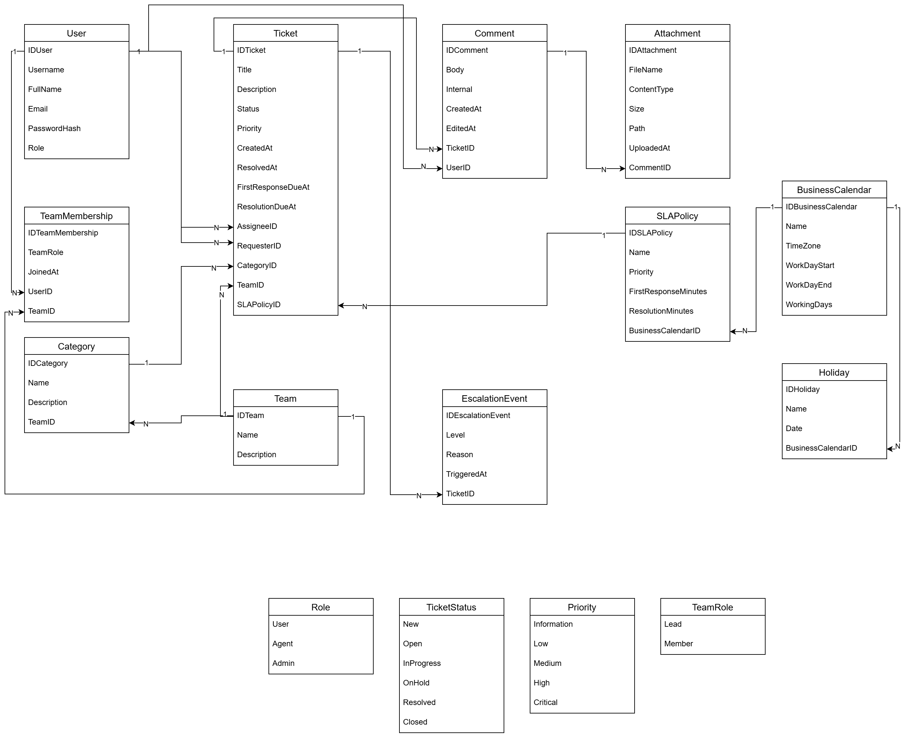

# Domain model – P12 Helpdesk and issue tracking

Source: [domain-model.drawio](domain-model.drawio)

## Aggregate
Ticket → Comment → Attachment; Ticket → SlaPolicy; Agent → Team

## Key decisions
- One `User` entity for all roles (USER, AGENT, ADMIN) – because every one of these roles share the same characteristics (identifier, username, full name, email, password (hash)). They only differ in what they are allowed to do, which Spring Security decides from the `Role` attribute.
- Agent ↔ Team through `TeamMembership` – many-to-many with its own
  attributes (`TeamRole`, `JoinedAt`). Join table could not store these attributes, so the association is a separate entity.
- Optional relations – `Ticket.AssigneeID` is empty until an agent picks the
  ticket up. `Ticket.TeamID` and `Category.TeamID` (default team) may also be empty.
- Category as an entity, not an enum – there can be need for some additional categories in the future so it is not good to "block" ourselves in advance. Each category can also have a default team, and the AI feature suggests a category from the ones that exist in the database.
- SLA in business time – SLAPolicy stores minutes of business time,
  BusinessCalendar + Holiday define what counts as business time (AR1).
- EscalationEvent – records each warning raised by the escalation job before SLA deadline is breached (AR2). It prevents the same ticket from being escalated twice at the same level and keeps a visible escalation history. `Level`, `Reason` and `TriggeredAt` describe each escalation.

## Enums
Role, TicketStatus, Priority, TeamRole – values are displayed in the diagram.